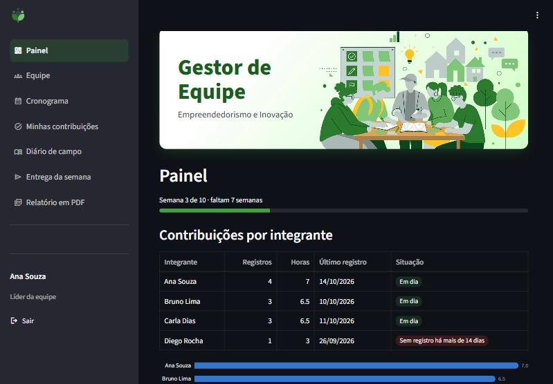
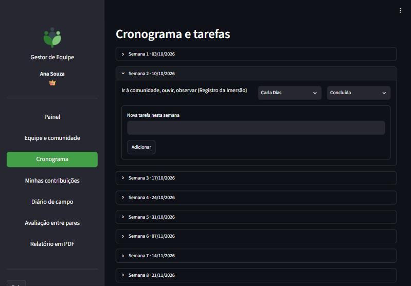
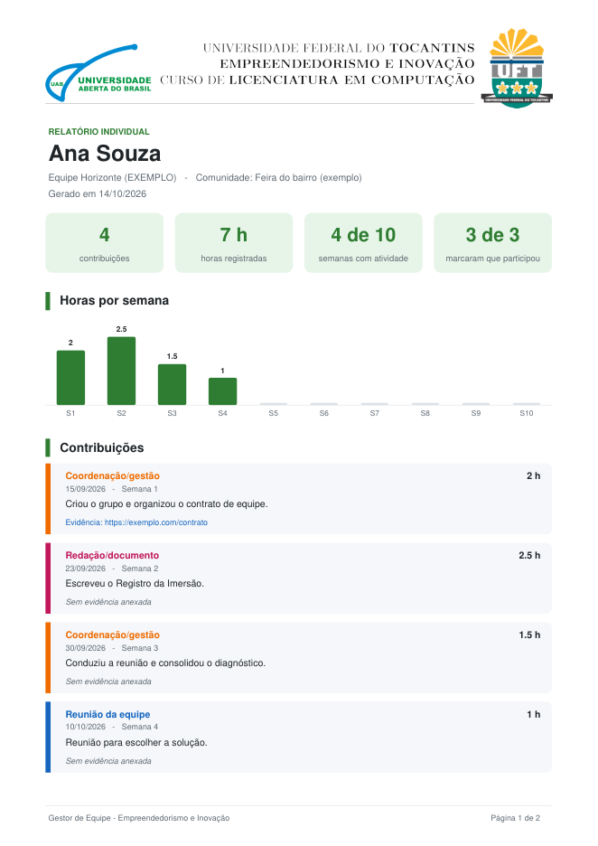

<p align="center">
  
</p>

# 🤝 Gestor de Equipe


> *Saber **quem fez o quê**, com prova, e manter o projeto andando semana a semana.*

Sistema web simples para uma equipe de estudantes organizar um projeto de empreendedorismo e inovação social: tarefas por semana, contribuição de cada integrante com evidência, diário de campo da comunidade e relatório individual em PDF. Feito em Python com [Streamlit](https://streamlit.io), com os dados em um banco SQLite local, sem serviços externos.

📌 *Criado para a disciplina de Empreendedorismo e Inovação, Licenciatura em Computação, UFT/UAB.*

📖 **Guia de uso para a equipe**: [GUIA-EQUIPE.md](GUIA-EQUIPE.md)

---

## ✨ O que ele faz

- 📊 **Painel**: horas e registros por integrante, tarefas por status, pendências com início e prazo, barra de progresso da semana e aviso de quem está há mais de 14 dias sem registrar nada.
- 👥 **Equipe**: nome da equipe e lista de integrantes. O líder tem um menu **⋯** em cada integrante (redefinir PIN, passar a liderança, remover ou excluir) e define o código de entrada.
- 🗓️ **Cronograma**: 10 semanas com início, prazo, responsável e status de cada tarefa. Editar tarefa, adicionar tarefa e alterar datas abrem em janela própria.
- 📝 **Minhas contribuições**: data, tipo, horas, descrição e evidência (link ou arquivo; as imagens aparecem em prévia). Filtro Minhas / Da equipe; editar e excluir em cada registro.
- 🌱 **Diário de campo**: visitas, entrevistas e observações na comunidade, com editar e excluir em cada registro.
- 📮 **Entrega da semana**: monta o texto da postagem do fórum (equipe, integrantes, contrato, comunidade, justificativa, contato, Diário de campo, tarefas e contribuições da semana), com botão **Copiar**.
- 📄 **Relatório em PDF**: contribuições do integrante, com evidência e cabeçalho institucional.
- 📱 **App instalável**: funciona no navegador e pode ser instalado no celular ou no computador.

## 🖼️ Telas

*Capturas feitas com os dados de exemplo (equipe fictícia).*

**📊 Painel**



**🗓️ Cronograma**



**📄 Relatório individual em PDF**



## 🔑 Como entrar

- 🚪 **Primeiro acesso (banco vazio)**: quem abrir primeiro cria a equipe, vira o líder 👑 e define o **código da equipe**.
- ➕ **Demais integrantes**: link "Sou novo no grupo", com nome, código da equipe e um PIN de 4 dígitos.
- 🔁 **Depois**: escolher o nome na lista e digitar o PIN. O login fica lembrado por 30 dias.

⚠️ *O PIN evita acesso por engano, mas não é segurança forte. Não registre informações sensíveis de moradores.*

## 🚀 Como rodar no computador

Requer Python 3.10 ou superior.

```
python -m venv .venv
.venv\Scripts\activate          # Windows
# source .venv/bin/activate     # Linux e macOS
pip install -r requirements.txt
python app.py
```

O `python app.py` abre o Streamlit sozinho no navegador. Também funciona com `streamlit run app.py`.

🧪 Para ver o sistema com **dados de exemplo** (equipe fictícia, PIN `1234`, código `exemplo26`):

```
python seed_exemplo.py            # só funciona com o banco vazio
python seed_exemplo.py --limpar   # apaga a pasta data/ e recria os exemplos
```

Para recomeçar do zero, apague a pasta `data/`.

## 🧭 Padrões de interface

Cada função usa o elemento que sistemas profissionais usam para ela:

- 🧭 **Navegação**: menu lateral nativo (`st.navigation`), com ícones, item ativo e um endereço por tela.
- 🪟 **Criar e editar**: janelas (`st.dialog`) com Cancelar e Salvar.
- ⚠️ **Excluir ou ação sem volta**: janela de confirmação, com botão vermelho.
- 🔎 **Filtros e seletores**: controle segmentado (`st.segmented_control`).
- ✏️ **Ações por linha ou cartão**: ícones de editar e excluir, sempre à direita.
- 🔔 **Sucesso**: notificação rápida (`st.toast`); erros aparecem dentro do formulário ou da janela.

## 🗂️ Estrutura

```
app.py               aplicação (telas, banco, login)
relatorio_pdf.py     geração do relatório em PDF
seed_exemplo.py      dados de exemplo
imagens/             logo, banner e cabeçalho do relatório
static/              manifest e ícones do app instalável, imagem de prévia
deploy/              script que grava as etiquetas de prévia de compartilhamento
.streamlit/          tema e configuração do Streamlit
data/                banco SQLite e anexos (criada na execução; não é versionada)
```

## 🌐 Colocar em um servidor

O sistema roda como um serviço comum de Streamlit atrás de um proxy HTTPS. Em linhas gerais:

1. 📥 Clonar o repositório, criar o ambiente virtual e instalar o `requirements.txt`.
2. ⚙️ Rodar como serviço (`systemd`, por exemplo) com `streamlit run app.py --server.address=127.0.0.1 --server.port=<porta> --server.headless=true`.
3. 🔒 Colocar um proxy (Nginx) com certificado HTTPS na frente, repassando WebSocket. Para anexos maiores, aumentar o `client_max_body_size`.
4. 💬 Opcional: gravar as etiquetas de prévia de compartilhamento (WhatsApp e similares) no `index.html` do Streamlit, repetindo após atualizar o Streamlit:

```
.venv/bin/python deploy/aplicar_meta_tags.py https://seu-dominio
```

💾 Os dados ficam na pasta `data/` do servidor. Faça cópia dela periodicamente.

## 🎨 Adaptar para outra equipe

- 🗓️ **Textos e prazos** das 10 semanas: lista `CRONOGRAMA`, no início do `app.py`.
- 🖼️ **Identidade visual**: troque os arquivos de `imagens/` e `static/` e a cor em `.streamlit/config.toml`.

## 📜 Licença

**MIT**. Pode usar, copiar e adaptar, mantendo o crédito. Veja o arquivo [LICENSE](LICENSE).
